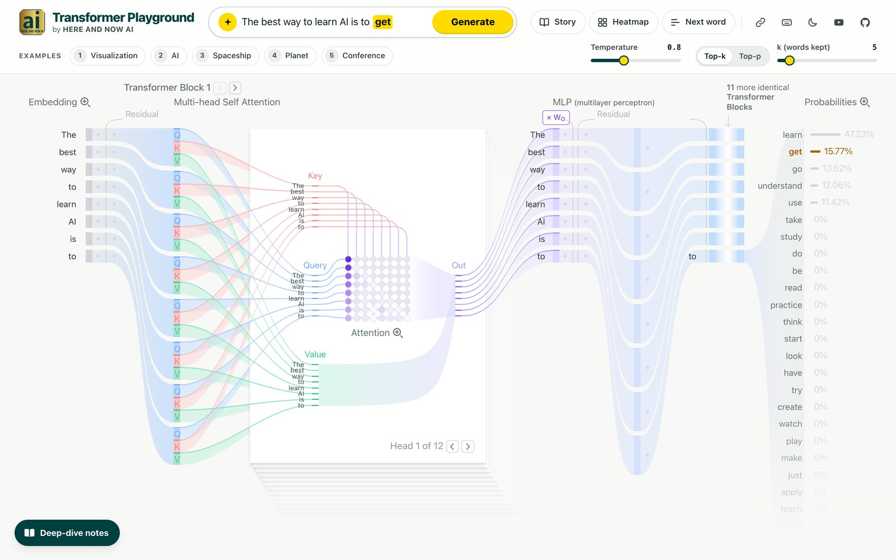
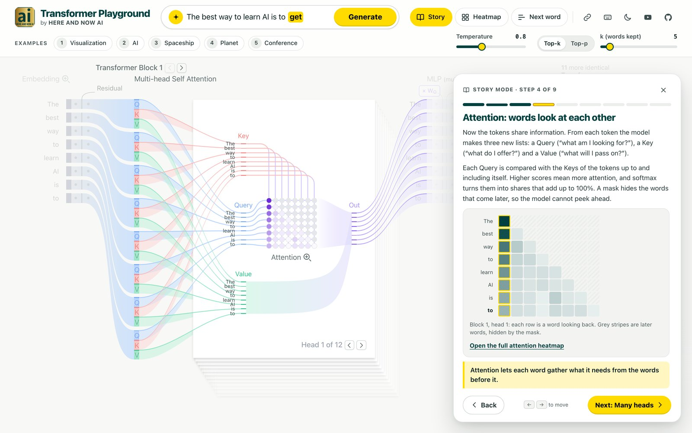
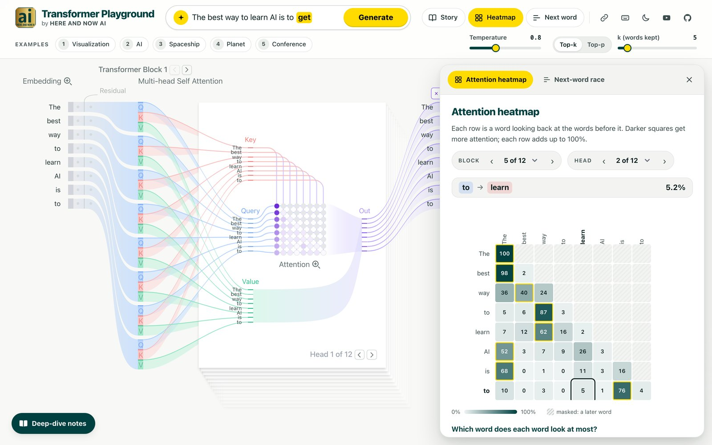
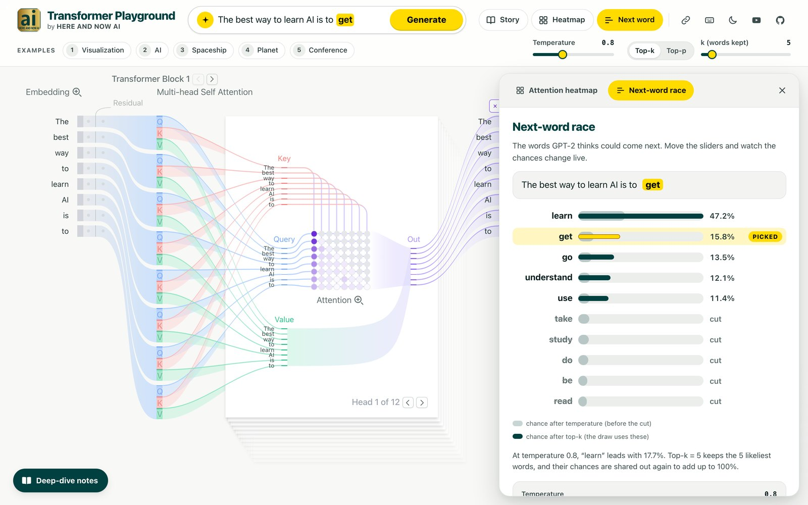

# Transformer Playground by HERE AND NOW AI

**See how a GPT-2 transformer picks its next word, live in your browser.** Type a sentence and follow every step:
tokens, embeddings, position, Query/Key/Value attention, the 12 heads, the MLP, residual connections and layer norm,
the 12 stacked blocks and the final probabilities. Explained simply, with the model's real numbers. Nothing to install,
no account, no tracking.

**Try it live: https://hereandnowai.github.io/transformer-playground/**

[](https://github.com/hereandnowai/transformer-playground/actions/workflows/ci.yml)
[](LICENSE)
[](https://arxiv.org/abs/1706.03762)



## Features

- **Story mode.** A guided tour in 9 steps, from tokens to the next word. Each step lights up its part of the live
  diagram, dims the rest and shows a small visual built from the model's own output (token IDs, attention weights,
  all 12 heads, the top next words). Back / Next, a clickable progress rail and the arrow keys.
- **Attention heatmap.** For any block and head: a token-by-token grid of attention weights with exact values on hover
  (or with the arrow keys), the causal mask marked, and a "which word does each word look at most?" list.
- **Next-word race.** Animated bars for the most likely next words, before and after top-k / top-p, the word that was
  picked, and live temperature and sampling controls. "Pick again" draws a new word.
- **Shareable links.** The prompt, temperature and top-k / top-p live in the address (`?q=…&t=…&k=…`), so you
  can share exactly what you see by copying the address bar. The link button in the top bar opens hereandnowai.com.
- **Keyboard shortcuts.** `/` prompt, `1`–`5` examples, `S` story, `←` `→` steps, `H` heatmap, `N` race, `L` visit
  hereandnowai.com, `T` theme, `Esc` close, `?` help.
- **Accessible.** Labelled controls, visible focus rings, screen-reader announcements, AA colour contrast, and less
  motion when your system asks for it.
- **Light and dark.** Light by default; dark is one click (or `T`) away and remembered on your device.
- **Phones.** A story-first page with the five ready-made examples, Story mode, the heatmap and the race. The live model
  (about 630 MB) runs on desktop and laptop browsers.
- **The full diagram.** Every part of GPT-2 small is drawn and clickable, including the attention output projection
  W<sub>O</sub>, plus 22 deep-dive notes and a section on the 2017 paper
  ["Attention Is All You Need"](https://arxiv.org/abs/1706.03762).
- **Private.** No analytics, no trackers, no third-party fonts. The page downloads only the model (from this site), the
  ONNX Runtime WebAssembly files (jsDelivr) and the GPT-2 tokenizer (Hugging Face).

| Story mode | Attention heatmap | Next-word race |
| --- | --- | --- |
|  |  |  |

## Run it on your computer

You need [Node.js](https://nodejs.org/) 20 or newer (npm 10 or newer comes with it).

```bash
git clone https://github.com/hereandnowai/transformer-playground.git
cd transformer-playground
npm install
npm run dev
```

Then open http://localhost:5173 in your browser. The first visit downloads the GPT-2 model (about 630 MB, in 63 parts)
into your browser's cache, so give it a minute; the examples work while it loads. It runs on your CPU through
WebAssembly.

Other commands:

```bash
npm run build      # static site in ./build (served under /transformer-playground)
npm run preview    # preview the production build
npm run check      # type-check (fails on any problem in our code)
npm run check:all  # the full svelte-check report, including the older upstream code
npm run deploy     # publish ./build to the gh-pages branch (GitHub Pages)
```

Every push and pull request runs install, build and check on GitHub Actions (`.github/workflows/ci.yml`).

## How it works

- **Model:** GPT-2 small (124 million parameters), exported to ONNX and run in the browser with
  [ONNX Runtime Web](https://onnxruntime.ai/) (`static/model-v2`). The model code follows Andrej Karpathy's
  [nanoGPT](https://github.com/karpathy/nanoGPT) (`src/utils/model`).
- **Tokenizer:** the GPT-2 tokenizer from [Transformers.js](https://github.com/xenova/transformers.js) (`Xenova/gpt2`).
- **Interface:** [SvelteKit](https://kit.svelte.dev/) and Svelte 5, with [D3.js](https://d3js.org/),
  [GSAP](https://gsap.com/), [KaTeX](https://katex.org/) and Tailwind CSS / Flowbite. The new tools live in
  `src/components/playground` (Svelte 5 runes, strict TypeScript) and `src/utils/playground`.

## Credits

Transformer Playground is a fork of **Transformer Explainer**, rebuilt with a new design and new tools by
[HERE AND NOW AI](https://hereandnowai.com).

- **Transformer Explainer** by Aeree Cho, Grace C. Kim, Alexander Karpekov, Seongmin Lee, Alec Helbling,
  Benjamin Hoover, Zijie J. Wang, Minsuk Kahng and Duen Horng (Polo) Chau, Polo Club of Data Science, Georgia Tech
  (MIT licence): https://github.com/poloclub/transformer-explainer.
  Paper: *Transformer Explainer: Learning LLM Transformers with Interactive Visual Explanation and Experimentation*,
  CHI 2026, [DOI 10.1145/3772318.3791725](https://doi.org/10.1145/3772318.3791725).
- **GPT-2** by OpenAI, released under a [modified MIT licence](https://github.com/openai/gpt-2/blob/master/LICENSE).
- **nanoGPT** by Andrej Karpathy (MIT).
- **Transformers.js** and the `Xenova/gpt2` tokenizer by Joshua Lochner (Xenova) / Hugging Face (Apache-2.0).
- **Dark mode** token system: community pull request poloclub/transformer-explainer#90 (author kept in the git history).
- **Attention Is All You Need** (Vaswani et al., 2017): https://arxiv.org/abs/1706.03762.

If you use the visualization in research, please cite the original authors:

```bibtex
@inproceedings{cho2026transformer,
  title={Transformer Explainer: Learning LLM Transformers with Interactive Visual Explanation and Experimentation},
  author={Cho, Aeree and Kim, Grace C and Karpekov, Alexander and Lee, Seongmin and Helbling, Alec and Hoover, Benjamin and Wang, Zijie J and Kahng, Minsuk and Chau, Duen Horng},
  booktitle={Proceedings of the 2026 CHI Conference on Human Factors in Computing Systems},
  pages={1--21},
  year={2026}
}
```

## About HERE AND NOW AI

HERE AND NOW AI teaches artificial intelligence, generative AI and agentic AI, explained simply for everyone.
*AI is Good.*

- Website: https://hereandnowai.com
- Email: info@hereandnowai.com
- YouTube: https://www.youtube.com/@hereandnow_ai
- GitHub: https://github.com/hereandnowai

Questions or ideas? [Open an issue](https://github.com/hereandnowai/transformer-playground/issues) or email us.

## Licence

MIT. See [LICENSE](LICENSE): the original copyright of the Polo Club of Data Science (2022) is kept, and HERE AND NOW AI
(2026) holds the copyright for the changes in this fork.
